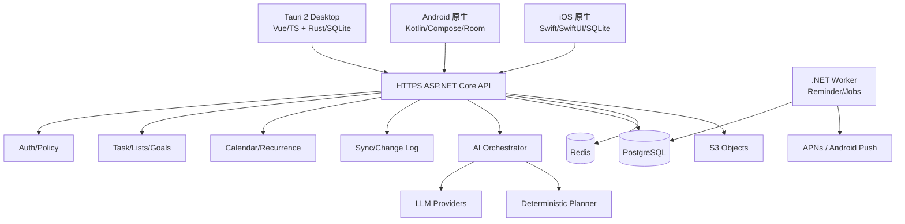
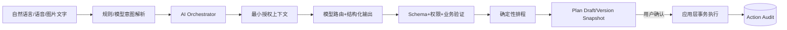

# 04｜全系统技术架构设计

## 1. ADR 式固定技术选型

后端 C# / ASP.NET Core（.NET 10.0），按业务模块组织可维护的模块化单体；简单 CRUD 使用 EF Core，复杂查询使用 Dapper，分别放在命令与查询的数据访问实现中，不混在一个 Repository。桌面 Tauri 2 + Vue 3/TS/Vite/Pinia，继续使用 Tauri Rust commands 访问本地 SQLite 和操作系统；Android 原生 Kotlin + Jetpack Compose + Room；iOS 原生 Swift + SwiftUI + SQLite/GRDB。后台数据库 PostgreSQL；Redis 只做可丢失缓存/限流，S3 兼容对象存储用于附件。

## 2. 高层系统组件

## 3. 服务端设计：模块化单体

- 一个 `api` 部署单元处理 HTTP、认证、领域用例、同步与 AI 编排入口；一个 `worker` 进程处理提醒、重复任务前瞻、AI 异步分析、清理任务。
- 领域模块 `identity`、`tasks`、`lists`、`calendar`、`recurrence`、`reminders`、`sync`、`habits`、`focus`、`goals`、`notes`、`ai`、`billing`。
- 每模块可有 domain/application/infrastructure/interfaces；不要每个模块都强制使用复杂 DDD 聚合。事务与所有者权限在 application 层统一实施。
- Application 用例依赖窄接口：写接口由 EF Core `DbContext` 与专用命令存储实现，复杂读接口由 Dapper 查询服务实现并返回只读投影。两者共享契约 DTO 和所有者权限规则，不共用一个混合 Repository。事务、幂等、版本和同步日志由应用服务统一协调。
- Auth：短期访问 token + 轮换 refresh token，服务端保存 refresh hash、device_id、失效状态；支持账号注销和设备会话撤销。
- 数据隔离：所有账户相关查询始终携带 owner_id（即使 UUID 难猜也不能作为授权凭证）。

## 4. 三端本地优先

- UI 只能订阅本地 DB 的数据（每端由 Repository/DAO 统一输出），远端同步更新本地数据库后自动刷新。
- 写操作在本地单事务内更新实体并加入 outbox；联网后批量推送 mutation；服务端 commit 产生全局递增 cursor 的变更记录；客户端增量拉取并应用到本地。
- 服务端 C# 领域逻辑不与 Tauri Rust 代码直接共享；桌面、Android 和 iOS 基于 OpenAPI/Schema 契约和同一组测试数据实现各自本地逻辑。
- 隐私敏感：本地库加密为增强选项；密钥放 Keychain/Keystore/系统凭据库，不能硬编码。

## 5. AI 平台架构

- 模型不直接连接 SQL；每个工具以用户 token 与租户授权执行。Prompt Injection 只能看作数据，不得改变工具策略。
- 准入：固定工具注册表、数据域白名单、单次上下文 token/调用预算、计划快照、人工确认、大批量操作上限、撤销和审计。
- 先确定性处理优先级/冲突/时长，LLM 主要负责语义解析、生成建议、自然语言解释。

## 6. 服务拆分时机

仅在有可测量证据时拆分：AI 请求长尾严重影响 API、通知 worker 独立扩容、推送 SLA/任务量明显增长。早期不要 Kafka/Kubernetes/全微服务。开始保留边界与 outbox、独立 worker 部署即可。

## 7. API 与一致性

- REST `/v1`，OpenAPI；UUID 客户端生成创建 ID，`Idempotency-Key`/`client_mutation_id` 去重；每对象 `version` 单调增加。
- Query side 遵循 owner_id、cursor 分页；错误统一 `code/message/details/request_id`；条件写入使用 `expected_version`。
- 同步采用 change log + tombstone 而不是更新时间戳轮询；服务端受理并发编辑时返回 conflict 数据。
- 风险：不提供多个客户端独立“最后写入永远覆盖”的默认策略。可对互不冲突字段进行安全合并，关键字段提示冲突。

## 8. 基础设施和安全边界

入口 TLS + WAF/限流（视业务规模）；API 通过反向代理部署；PG 非公网；Redis 私网；S3 私有桶+签名URL；AI Provider 凭据只在服务端；生产 Secrets 管理；分环境部署与隔离账号；前端构建产物/桌面更新签名和移动端签名独立保存。

## 9. 数据流主场景

### 场景 A：离线创建

Kotlin/Swift/Tauri → SQLite `tasks+outbox` 事务 → UI 立即显示 → 后台 sync/push → 服务端校验/写 PostgreSQL/生成 changelog → 客户端标记确认 → 第二设备 pull 显示。

### 场景 B：AI 排程

UI 输入 → ASP.NET Core API → AI 读经授权的 task/calendar 数据 → 排程引擎计算 → 返回 `plan_id/snapshot_hash/operations` → UI 展示 → 用户显式确认 → apply 事务校验所有 expected_version → 持久化并发出 sync events → 所有端同步。

### 场景 C：提醒

客户端本地依据近期任务编排提醒；服务端 worker 同时负责必要的远程推送策略。带 delivery_key 去重，注意 APNs/Android 推送受设备网络与系统策略限制、不得宣称绝对准点。

## 10. 重要质量属性

- 正确性 > AI 文字效果；数据不可丢、可恢复。
- P99 本地交互与同步延迟分别度量；端到端日志以 request_id/trace_id 串联，不记录明文任务标题。
- 故障隔离：AI Provider 限流/降级只影响 AI，核心任务、提醒、同步独立可用。
- 可观测：sync failure、deadletter jobs、提醒尝试/回执、AI parse_fail/schema_fail/cost/latency。

## 11. 基线待确认项

目标操作系统最低版本、商标/域名、国内推送厂商渠道、对象存储地域、商店订阅平台策略、加密库选择、用户是否允许纯本地账户。这些不会改变核心架构，但在商店发布前须由产品/法务/技术共同锁定。
